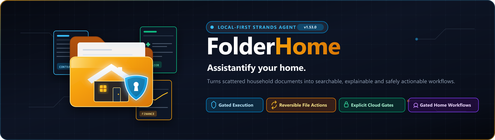

# FolderHome

**English** | [Deutsch](./README.de.md)

> Assistantify your home.

This is the concise project entrypoint. It replaces the detailed README archived at [`docs/archive/README-through-2026-10-13.md`](./docs/archive/README-through-2026-10-13.md), a corrected archive derived from source commit [`dac6541`](https://github.com/ellmos-ai/FolderHome/blob/dac6541ba0f6429d38d4ee3bffec08a94316213c/README.md). The original source text remains available at that commit. Version-specific test and hosted-demo notes in the archive are historical records, not current acceptance evidence.

FolderHome is a Python application for searching selected household documents and preparing reviewable workflows. Its package version is **0.6.1** and it requires Python **3.11 or newer**. The application can use configured model and service providers; network access and external effects depend on the selected provider and its approval gates. The operating-system account is the local security boundary; profiles are organizational views, not isolation.

- [Privacy and data flows](./PRIVACY.md)
- [Security boundaries and reporting](./SECURITY.md)
- [Architecture](./ARCHITECTURE.md) · [German architecture](./ARCHITECTURE.de.md)
- [Changelog](./CHANGELOG.md)
- [License](./LICENSE)

## Status

The source version is 0.6.1. Historical run counts, live-provider checks, hosted-demo versions, and competition acceptance notes are kept in the corrected archive and do not describe current verification. The static showcase in [`site/`](./site/) is separate from the executable application.

[Archived status details](./docs/archive/README-through-2026-10-13.md#status).

## Quick test for jurors

This synthetic demo uses the fixture provider and writes only to the chosen local output directory. Installing the project downloads build and dependency packages from the configured package index.

Windows PowerShell:

```powershell
git clone https://github.com/ellmos-ai/FolderHome.git
cd FolderHome
py -3.11 -m venv .venv
.venv\Scripts\python.exe -m pip install -e ".[dev,transform]"
.venv\Scripts\python.exe -m folderhome demo run `
  --output-dir .local-demo\competition `
  --approve-output-write --json
```

macOS/Linux:

```sh
git clone https://github.com/ellmos-ai/FolderHome.git
cd FolderHome
python3.11 -m venv .venv
.venv/bin/python -m pip install -e ".[dev,transform]"
.venv/bin/python -m folderhome demo run \
  --output-dir .local-demo/competition \
  --approve-output-write --json
```

The demo uses synthetic inputs and does not make a model-provider request. The `--approve-output-write` flag permits creation of the demo output files in that directory.

[Archived demo and journey details](./docs/archive/README-through-2026-10-13.md#quick-test-for-jurors).

## Interactive accident journey

The repository includes a synthetic accident walkthrough. Its local command, interface, and fixture details are documented in the archive; live provider use remains subject to the separate network, data-sharing, and effect approvals described in [Security](./SECURITY.md).

[Archived journey details](./docs/archive/README-through-2026-10-13.md#interactive-accident-journey).

## Agent architecture

FolderHome runs its Python application locally. It can call configured model or domain providers when enabled; a local process is not a network sandbox. The architecture guide documents the application components and their boundaries.

[Architecture guide](./ARCHITECTURE.md) · [Archived diagram and details](./docs/archive/README-through-2026-10-13.md#agent-architecture).

## What FolderHome can do locally

The application supports document search, local output preparation, status views, and gated domain workflows. Exact availability depends on configured resources and optional dependencies; see the architecture and configuration guides.

[Archived capability details](./docs/archive/README-through-2026-10-13.md#what-folderhome-can-do-locally).

## Security model

The operating-system account and its file permissions define the local security boundary. Profiles do not isolate users. The app uses explicit gates for supported network calls and external effects; child processes inherit the launching process's privileges. FolderHome does not provide an operating-system sandbox or prevent other processes from using the network.

See [Security](./SECURITY.md) and [Privacy](./PRIVACY.md) for the implementation scope and data flows.

[Archived security-model details](./docs/archive/README-through-2026-10-13.md#security-model).

## Private logical resources

FolderHome can expose configured resource names to its agent workflows while keeping physical resource locations outside those model-facing catalogs. Review the resource registry and privacy guide before configuring real household data.

[Archived resource details](./docs/archive/README-through-2026-10-13.md#private-logical-resources).

## Local model via Ollama

Ollama is an optional model provider. A loopback endpoint stays on the local machine; a model hosted on another machine uses the network and requires the applicable approvals.

[Archived Ollama instructions](./docs/archive/README-through-2026-10-13.md#local-model-via-ollama).

## Model providers

The project includes a deterministic fixture and optional integrations for configured model providers. Check the current dependency extras and provider instructions before enabling one.

[Archived provider setup and notes](./docs/archive/README-through-2026-10-13.md#model-providers).

## Use FolderHome from Claude Code or Codex (MCP)

FolderHome includes a local MCP entrypoint. Its transport and setup instructions are in the archive; starting a local process does not grant the connected editor additional operating-system restrictions.

[Archived MCP instructions](./docs/archive/README-through-2026-10-13.md#use-folderhome-from-claude-code-or-codex-mcp).

## Results you can pick up

Generated files and reports are stored locally at the configured output paths. They may contain user-provided content, so inspect them before sharing.

[Archived result details](./docs/archive/README-through-2026-10-13.md#results-you-can-pick-up).

## Set up FolderHome (local installer)

The repository includes a separate setup command. Review its requested paths and actions before running it; it executes with the current user's permissions.

[Archived setup instructions](./docs/archive/README-through-2026-10-13.md#set-up-folderhome-local-installer).

## Direct HTTP API

The local HTTP interface is optional and has its own loopback and session-token controls. It is not a remotely hosted API service.

[Archived API instructions](./docs/archive/README-through-2026-10-13.md#direct-http-api).

## Important commands

Use the CLI's built-in help to see the commands supported by the installed version:

```powershell
.venv\Scripts\python.exe -m folderhome --help
```

[Archived command reference](./docs/archive/README-through-2026-10-13.md#important-commands).

## Development verification

Run the repository checks from an installed development environment:

Windows PowerShell:

```powershell
.venv\Scripts\python.exe -m pytest
.venv\Scripts\python.exe -m ruff check .
.venv\Scripts\python.exe -m compileall -q src tests
```

macOS/Linux:

```sh
.venv/bin/python -m pytest
.venv/bin/python -m ruff check .
.venv/bin/python -m compileall -q src tests
```

These checks do not perform a live-provider, browser, or hosted-runtime acceptance test. Optional integration tests may require the exact provider checkouts listed in [provider checkouts](./docs/provider-checkouts.md).

[Archived development-check details](./docs/archive/README-through-2026-10-13.md#development-verification).

## Repository structure and provenance

The repository contains the Python application, component manifests, tests, documentation, and a static synthetic showcase. See the directory tree and component lineage in the guides.

[Archived structure details](./docs/archive/README-through-2026-10-13.md#repository-structure-and-provenance).

## Privacy-friendly chat focus and roadmap

Chat and retention behavior depend on the configured application path. The privacy guide describes what reset and close do; the project does not promise deletion of files or data retained by external providers.

[Archived roadmap notes](./docs/archive/README-through-2026-10-13.md#privacy-friendly-chat-focus-and-roadmap).

## Submission limit

Competition materials and historical submission boundaries are preserved in the archive. They are not a current certification or release gate.

[Archived submission notes](./docs/archive/README-through-2026-10-13.md#submission-limit).

## License

FolderHome is distributed under the MIT License. See [`LICENSE`](./LICENSE) and the component-specific inventory in [`THIRD_PARTY_LICENSES.md`](./THIRD_PARTY_LICENSES.md).

[Archived license notes](./docs/archive/README-through-2026-10-13.md#license).
